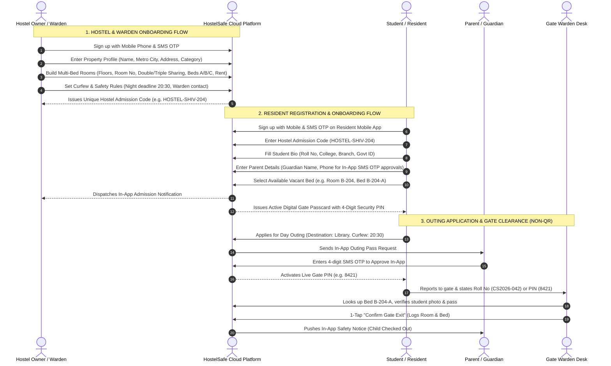

# HostelSafe: Phased Architecture & SaaS Commercial Strategy

**HostelSafe** is a cloud-native, multi-tenant Student Living & Hostel Safety Governance Platform. It is engineered to support everything from boutique independent PGs to multi-city university campus chains with thousands of residents.

To provide a frictionless path to market and accommodate diverse hostel operating budgets, HostelSafe is structured into **two distinct deployment phases**:

- **Phase 1: Pure Software / Dual-Surface SaaS (Zero Hardware & Zero QR Code Dependency)**:
  - **Hostel / Owner / Warden Registration Wizard**: Self-serve property onboarding, multi-bed room configuration, curfew policies, and automated **Hostel Admission Code** generation (`HOSTEL-SHIV-204`).
  - **Resident Registration & Onboarding Wizard**: Student sign-up with SMS OTP, hostel code binding, student profile/roll number, parent guardian linkage, vacant bed selection, and instant digital passcard activation.
  - **Multi-Bed Room Architecture**: Shared rooms (Single, Double, Triple sharing, and dorms) with bed-level resident assignment (`Bed 204-A`, `Bed 204-B`), vacancy tracking, and bed-level rent collection.
  - **Non-QR Gate Clearance**: Elimination of QR codes and camera scanning dependencies. Verification is powered by **Dynamic 4-Digit Digital Gate PINs** and **Instant Roll Number / Bed ID lookup**.
  - **SMS OTP Authentication & Strictly In-App Notifications**: Passwordless security and zero WhatsApp dependency.
  - **Dual-Surface Coverage for All Roles**: Dedicated **Website Dashboards AND Mobile Apps** for both **Admin** and **Warden**, plus **Resident** and **Parent** Mobile Apps.
- **Phase 2: IoT Hardware & Biometric Turnstile Security Suite**: Physical access barriers, USB OTG biometric scanners, AI face kiosks, motorized flap barrier relays, RTSP surveillance integration.

---



---

## Detailed Onboarding Flows

### Flow 1: How a Warden / Owner Registers their Hostel
1. **Mobile Authentication**:
   - Owner/Warden enters mobile number and validates with a secure 4-digit SMS OTP.
2. **Hostel Property Profile**:
   - Enters Hostel/PG Name (e.g. *Shivalik Student Living*), City (*Delhi NCR*), Full Address, Category (*Boys, Girls, or Co-Ed*), and GSTIN/Govt Registration (optional).
3. **Multi-Bed Room & Pricing Builder**:
   - Configures campus layout: Wing (*Wing B*), Floor (*2nd Floor*).
   - Adds Rooms with sharing capacity: Single (1 Bed), Double Sharing (Bed A, Bed B), Triple Sharing (Bed A, Bed B, Bed C).
   - Sets monthly rent per bed (e.g. ₹9,500/month) and security deposit.
4. **Curfew & Gate Policies**:
   - Sets evening gate closing deadline (e.g., *20:30*), late grace period (*15 mins*), and warden emergency phone number.
5. **Activation & Admission Code Issuance**:
   - System deploys the property to the HostelSafe cloud and generates a unique **Hostel Admission Code** (e.g. `HOSTEL-SHIV-204`).
   - Owner can share this code with students via SMS or invite staff wardens.

---

### Flow 2: How a Resident Registers & Gets Onboarded
1. **Resident Mobile Authentication**:
   - Student downloads the HostelSafe mobile web app, enters their phone number, and verifies via SMS OTP.
2. **Join Hostel via Admission Code**:
   - Enters the Hostel Admission Code (e.g. `HOSTEL-SHIV-204`) or selects the hostel from the directory.
3. **Student Bio & Academic Credentials**:
   - Enters Full Name, Institute/University (*Delhi Technical Campus*), Course/Branch (*B.Tech CS*), and Student Roll Number (*CS2026-042*).
4. **Parent / Guardian Linkage**:
   - Enters Parent/Guardian Name (*Rajesh Sharma*), Relationship (*Father*), and Parent Mobile Number (*+91 98110 99881*).
   - This binds the guardian to the student account so all outing requests trigger **In-App SMS OTP authorizations**.
5. **Room & Bed Allocation Selection**:
   - Student views available vacant beds in the hostel (e.g., `Room B-204 • Bed A (Double Sharing)`).
   - Confirms bed booking, reviews the digital hostel rulebook, and accepts house regulations.
6. **Active Digital Passcard Issuance**:
   - Student is immediately granted an active **Digital Gate Passcard** showing their Photo, Roll No, Room, Bed ID, and live **4-Digit Rotating Security PIN**.

---

## Phase 1 Complete Screen Inventory

| Screen Name | Target Role | Surface Type | Primary Operational Features |
| :--- | :--- | :--- | :--- |
| **1. Register Hostel Wizard** | Owner / Warden | Web / Mobile | 4-step wizard: Property profile, multi-bed room builder, curfew rules, admission code generation. |
| **2. Resident Onboarding Wizard** | Student | Mobile / Web | 5-step wizard: Code join, student roll no, guardian phone binding, vacant bed selection, pass activation. |
| **3. Admin Web Dashboard** | Owner / Director | Desktop / Laptop | Multi-property switcher, visual room & bed sharing matrix, rent ledger, compliance police audit log export. |
| **4. Admin Mobile App** | Owner / Director | Mobile Shell | Executive pocket console, occupied/vacant bed counts, 1-tap curfew broadcast, urgent defaulter escalation. |
| **5. Warden Web Station** | Front-Desk Warden | Gate PC / Laptop | Non-QR gate desk, fast Roll No / Bed ID / 4-Digit PIN search, 1-tap gate exit/entry, live gate audit stream. |
| **6. Warden Mobile App** | Roaming Warden | Mobile Shell | Bed-by-Bed Night Floor Headcount Checklist, roaming incident logger, direct student call/ping. |
| **7. Resident Pass App** | Student | Mobile Shell | Digital passcard with 4-digit security PIN, room & bed details, apply day/night pass, in-app notifications. |
| **8. Parent Guardian App** | Parent / Guardian | Mobile Shell | Multi-child cross-city tracking with bed IDs, in-app pass review, SMS OTP authorization modal, safety feed. |
| **9. SaaS Plans & Commercials** | All Roles | Responsive Web | Phase 1 Starter (₹1,999) & Campus Pro (₹5,999) tiers, zero hardware guarantee, Phase 2 hardware upgrade path. |

---

## Commercial SaaS Pricing & Packaging

```
+---------------------------------------------------------------------------------------------------------+
|                                        HOSTELSAFE PRICING MATRIX                                        |
+------------------------------------+------------------------------------+-------------------------------+
| PHASE 1: SOFTWARE-ONLY SAAS        | PHASE 2: HARDWARE-CONNECTED SUITE  | ENTERPRISE MULTI-CITY CHAIN   |
+------------------------------------+------------------------------------+-------------------------------+
| Starter Digital    | Campus Pro    | Smart Hardware     | Hardware Pro  | Enterprise Matrix             |
| ₹1,999 / mo        | ₹5,999 / mo   | ₹14,999 / mo       | ₹24,999 / mo  | ₹39,999 / mo                  |
| Up to 80 Beds      | Up to 400 Beds| Up to 600 Beds     | Up to 1500 Beds| Unlimited Beds                |
| Zero Hardware      | Zero Hardware | 2 Turnstiles       | 4 Turnstiles  | Unlimited Gates & Metros      |
| Multi-Bed Ledger   | Multi-Bed     | Mantra USB OTG     | Face AI Kiosk | Dedicated SLA & Edge Sync     |
| PIN Gate Desk      | PIN Gate Desk | Motorized Flap     | CCTV Snapshots| Multi-City Hardware Fleet     |
+--------------------+---------------+--------------------+---------------+-------------------------------+
```
