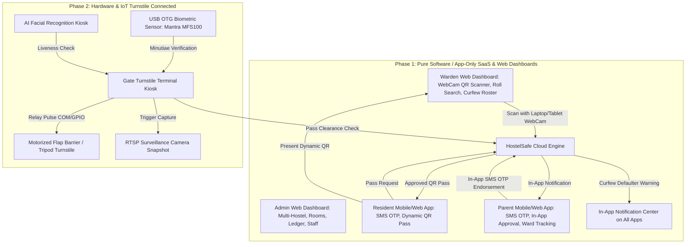

# HostelSafe: Phased Architecture & SaaS Commercial Strategy

**HostelSafe** is a cloud-native, multi-tenant Student Living & Hostel Safety Governance Platform. It is engineered to support everything from boutique independent PGs to multi-city university campus chains with thousands of residents.

To provide a frictionless path to market and accommodate diverse hostel operating budgets, HostelSafe is structured into **two distinct deployment phases**:

- **Phase 1: Pure Software / App-Only SaaS + Web Dashboards** (Zero hardware investment, instant 5-minute setup, dynamic QR passes, SMS OTP authentication, all notifications strictly in-app, dedicated Admin and Warden web dashboards).
- **Phase 2: IoT Hardware & Biometric Turnstile Security Suite** (Physical access barriers, USB OTG biometric scanners, AI face kiosks, motorized flap barrier relays, RTSP surveillance integration).

---



---

## Phase Comparison & Technical Matrix

| Capability | Phase 1: Software-Only SaaS + Web Dashboards | Phase 2: Hardware & IoT Connected |
| :--- | :--- | :--- |
| **Target Customers** | Independent PGs, private hostels, coaching hub residences (Kota, Delhi, Pune, Bengaluru) | University campuses, premier residential institutions, enterprise student housing (Oxford, Shivalik, Stanza) |
| **Hardware Required** | **None** (runs on existing laptops, smartphones, tablets, or office PCs) | USB OTG Biometric Sensor (Mantra MFS100 / SecuGen), Motorized Flap Barrier / Turnstile, IoT Relay Controller |
| **Admin & Warden Interfaces** | **Dedicated Responsive Web Dashboard Website** for Admin (management, ledger, rooms) and Warden (live gate desk, webcam scanner, curfew defaulter desk) | All Phase 1 Web Dashboards + Gate Kiosk terminal app with relay pulse controls and hardware health status |
| **Setup & Onboarding Time** | **< 5 minutes** (Self-serve sign-up, bulk CSV student import, instant activation) | **2 - 5 days** (Turnstile mounting, LAN wiring, biometric template enrollment) |
| **Upfront Capital Cost** | **₹0** (Zero CapEx) | ₹45,000 – ₹1,80,000 per gate lane |
| **Authentication & Verification** | **SMS OTP** for secure login & pass approval. Dynamic QR Code (30s rotation) + Roll Number manual lookup | Optical Fingerprint (ISO 19794-2 minutiae) + AI Facial Recognition + RFID Card |
| **Notification Channel** | **Strictly In-App Notifications** (In-App Notification Center, push alerts, in-app pass approval requests; no external WhatsApp dependency) | In-App Notifications + Gate Kiosk audio-visual alerts + turnstile screen prompts |
| **Barrier Operation** | Warden visual green/red approval on web dashboard + audible prompt for manual guard gate | Motorized automated barrier release via electrical relay pulse (GPIO / RS485 / TCP Relay) |
| **Parent Authorization** | **In-App Parent Portal** with secure **SMS OTP verification** (Parent reviews request inside app and confirms via OTP) | In-App Parent Portal with SMS OTP + Biometric audit stamp on departure |
| **Surveillance Snapshots** | Optional manual device camera capture on gate check-out | Automated LAN RTSP camera frame capture upon turnstile unlocking |
| **Offline Reliability** | Progressive Web App (PWA) with client-side cache and background queue | Local Edge controller running embedded SQLite sync with fail-open emergency bypass |

---

## Phase 1 Feature Architecture

### 1. Admin Web Dashboard Website
- **Multi-Property & Multi-City Switcher**: Oversee multiple hostels and wings from a single unified portal.
- **Occupancy & Room Ledger**: Real-time room allocation, bed availability, and dues/rent collection tracking.
- **Curfew Policy Engine**: Set per-hostel or per-wing evening curfew deadlines and grace periods.
- **Staff Access Control**: Assign roles for Wardens, Accountants, and Gate Security personnel.
- **In-App Announcement Broadcaster**: Dispatch instantaneous in-app alerts to residents and parents.

### 2. Warden Web Dashboard Website
- **Gate Check-in / Check-out Desk**: Real-time monitoring of all incoming and outgoing residents.
- **Web Camera QR Scanner**: Uses standard laptop webcam, tablet camera, or smartphone browser camera to scan dynamic QR codes without specialized scanners.
- **Manual Roster Search**: Instant lookup by Roll Number, Room Number, or Name when student phones run out of battery.
- **Curfew Defaulter Monitor**: Real-time list of residents who have not returned past curfew deadline, with 1-click in-app alert triggers.
- **Incident & Emergency Logger**: Quick digital log for gate incidents, medical emergencies, or disciplinary notes.

### 3. Resident Mobile / Web App
- **Secure SMS OTP Login**: Passwordless, tamper-proof mobile verification.
- **Dynamic QR Gate Pass**: Time-rotating HMAC QR code that refreshes every 30 seconds to prevent screenshot sharing.
- **Pass Application**: Apply for Day Outing, Night Outing, or Weekend Leave.
- **In-App Notification Center**: Instant in-app alerts on pass status, curfew countdown, and warden notices.

### 4. Parent Guardian Mobile / Web App
- **Secure SMS OTP Login**: Quick access via registered guardian phone number.
- **Multi-Child Cross-City Tracking**: Monitor siblings staying in different hostels across multiple cities on one screen.
- **In-App Outing Pass Authorization**: Review outing details (destination, return time) and approve or reject securely using an **SMS OTP**.
- **In-App Safety Feed**: Live in-app notifications whenever the child exits or enters hostel premises.

---

## Commercial SaaS Pricing & Packaging

```
+---------------------------------------------------------------------------------------------------------+
|                                        HOSTELSAFE PRICING MATRIX                                        |
+------------------------------------+------------------------------------+-------------------------------+
| PHASE 1: SOFTWARE-ONLY SAAS        | PHASE 2: HARDWARE-CONNECTED SUITE  | ENTERPRISE MULTI-CITY CHAIN   |
+------------------------------------+------------------------------------+-------------------------------+
| Starter Digital    | Campus Pro    | Smart Hardware     | Hardware Pro  | Enterprise Matrix             |
| ₹1,999 / mo        | ₹5,999 / mo   | ₹14,999 / mo       | ₹24,999 / mo  | ₹39,999 / mo                  |
| Up to 80 Beds      | Up to 400 Beds| Up to 600 Beds     | Up to 1500 Beds| Unlimited Beds                |
| Zero Hardware      | Zero Hardware | 2 Turnstiles       | 4 Turnstiles  | Unlimited Gates & Metros      |
| Dynamic QR Passes  | In-App Alerts | Mantra USB OTG     | Face AI Kiosk | Dedicated SLA & Edge Sync     |
+--------------------+---------------+--------------------+---------------+-------------------------------+
```

### Detailed Tier Breakdown

#### 1. Phase 1: Starter Digital (₹1,999 / month + GST)
*Best for: Boutique PGs and standalone hostel buildings up to 80 residents.*
- Up to **80 Resident Beds** (1 Property)
- **Zero Hardware Required** (runs on phone, tablet, laptop)
- Dedicated **Admin & Warden Web Dashboard**
- Dynamic QR Gate Pass system with anti-screenshot 30s rotation
- Warden Web Camera Scanner & Manual Roll Search Desk
- **SMS OTP Authentication** for students and parents
- **In-App Notification Center** for pass status and curfew alerts
- Room Inventory & Rent/Dues Ledger
- Maintenance Complaint Ticketing

#### 2. Phase 1: Campus Digital Pro (₹5,999 / month + GST)
*Best for: Multi-wing private hostels and coaching hub residencies up to 400 students.*
- Up to **400 Resident Beds** (Up to 3 Properties/Wings)
- **Zero Hardware Required**
- Everything in Starter Digital, plus:
- Multi-Property Admin Web Dashboard with cross-wing analytics
- **Multi-Child Family Guardian Portal** (parents track siblings across different cities)
- **In-App Outing Pass Approval with SMS OTP Verification**
- In-App Evening Curfew Defaulter Broadcast System
- Exportable Police & Institutional Regulatory Compliance Audit Logs
- Finance Analytics & Online Fee Collection Gateway integration

#### 3. Phase 2: Smart Hardware Campus (₹14,999 / month + GST)
*Best for: College hostels and student complexes needing automated biometric turnstiles.*
- Up to **600 Resident Beds**
- Supports up to **2 Physical Hardware Gate Turnstiles**
- Everything in Campus Digital Pro, plus:
- USB OTG Biometric Sensor Driver (Mantra MFS100 / Startek FM220)
- Motorized Flap Barrier Relay COM/GPIO driver (auto barrier opening)
- Biometric minutiae storage & tamper-proof validation
- Warden Kiosk terminal station with audible alarms for unauthorized access
- Priority 24/7 technical helpdesk

#### 4. Phase 2: Enterprise Turnstile Matrix (₹39,999 / month + GST)
*Best for: Multi-city university networks and large student housing groups (1000+ residents).*
- **Unlimited Resident Beds** across multiple cities
- Supports **Unlimited Physical Turnstiles, AI Face Kiosks & Flap Barriers**
- Everything in Smart Hardware Campus, plus:
- Automated LAN RTSP CCTV Snapshot capture upon turnstile unlocking
- Local Edge Server synchronization (zero gate delay, offline fail-safe)
- Anti-tailgating sensor beam integration
- Custom Active Directory / University ERP single sign-on (SSO)
- Dedicated Account Manager & on-site field engineering SLA

---

## Immediate Next Steps & Migration Path

1. **Hostels start on Phase 1**: Operators sign up, import resident CSVs, and begin digital gate tracking within 5 minutes without spending on hardware.
2. **Seamless In-App Upgrades**: When student volume grows or campus regulations require physical turnstiles, hostels upgrade to Phase 2 with a single click, preserving all student rosters, parent accounts, and historical audit logs.
